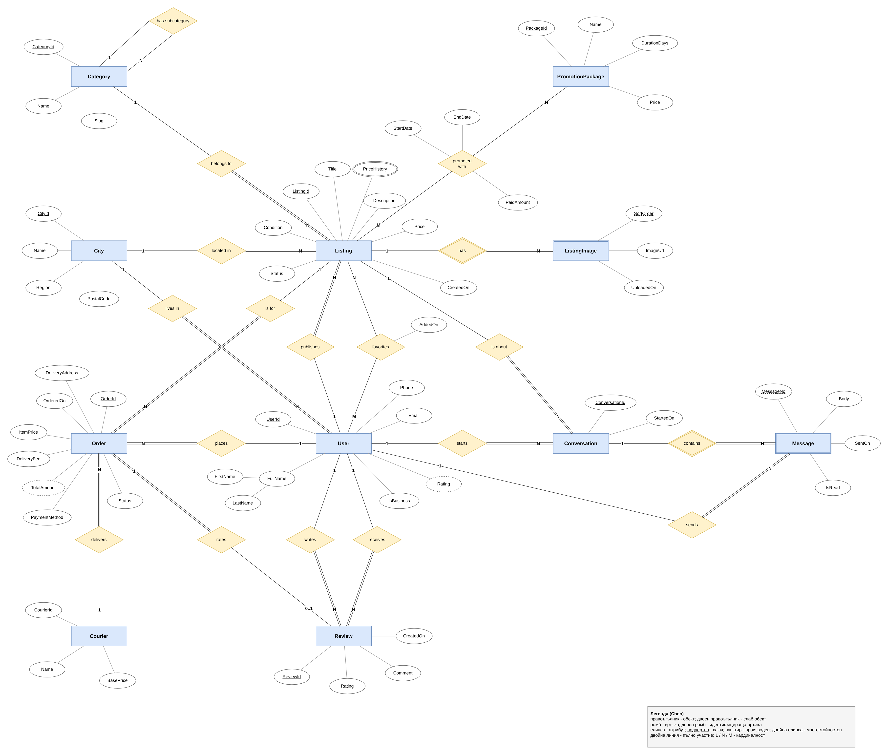
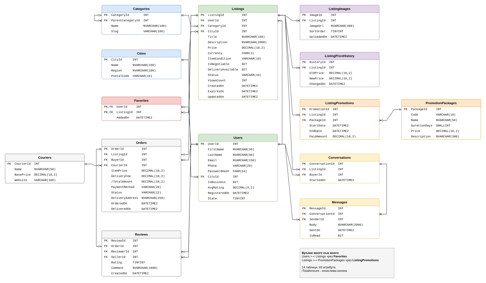
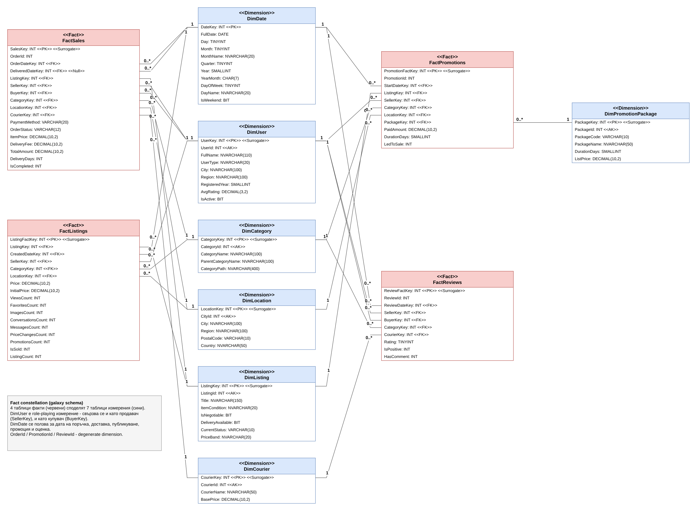

# OLX.bg - модел на данни, база данни и Data Warehouse

**Курсова работа по Моделиране и анализ на софтуер**

| | |
|---|---|
| Студент | `Ангел Дойчев` |
| Факултетен номер | `2401322001` |
| Тема (платформа) | OLX.bg - https://www.olx.bg/ |

## Описание на проекта

OLX е платформа за обяви, в която потребителите публикуват обяви за продажба на вещи (телефони, мебели, коли, дрехи и т.н.), а други потребители ги разглеждат, добавят в любими и пишат на продавача в чата. Част от обявите могат да се купят директно през **OLX доставка** - купувачът плаща с карта или с наложен платеж, а пратката се изпраща чрез Speedy, Еконт или BOX NOW. След доставката купувачът може да остави оценка на продавача. Продавачите могат да платят за промотиране на обявата (Топ обява, обновяване, VIP пакет).

В проекта съм моделирал тази част от платформата:

- **концептуален модел** (Chen) и **логически модел** (Crow's Foot)
- **OLTP база данни** `OlxDB` на MS SQL Server - 14 таблици, функции, съхранени процедури, тригери, изгледи и тестови данни
- **Data Warehouse** `OlxDW` - схема "фактически съзвездия" с 4 таблици факти и 7 таблици измерения + ETL процедура
- **Power BI отчет** върху данните от склада

Цените са в евро (от 01.01.2026 г. България е в еврозоната и обявите в OLX вече са в EUR).

## Структура на папката

```
olx-marketplace/
├── README.md
├── install.bat                     -> инсталира всичко с sqlcmd
├── diagrams/
│   ├── olx_conceptual_chen.drawio  (+ .png)  -> концептуален модел, Chen
│   ├── olx_logical_crowsfoot.drawio (+ .png) -> логически модел, Crow's Foot
│   └── olx_datawarehouse_uml.drawio (+ .png) -> физически модел на DW, UML
├── sql/
│   ├── 01_create_database.sql      -> база, схеми, таблици, ограничения, индекси
│   ├── 02_functions.sql            -> 3 функции
│   ├── 03_stored_procedures.sql    -> 5 съхранени процедури
│   ├── 04_triggers.sql             -> 4 тригера
│   ├── 05_views.sql                -> 2 изгледа
│   ├── 06_seed_data.sql            -> тестови данни (генерирани)
│   └── 07_test_queries.sql         -> примери за ползване на всичко горе
├── data-warehouse/
│   ├── 01_create_dw.sql            -> таблици факти и измерения
│   └── 02_load_dw.sql              -> ETL процедура USP_LoadWarehouse
├── power-bi/
│   ├── README.md                   -> как е изграден отчетът (модел, визуализации)
│   ├── measures.dax                -> DAX мерки
│   └── OLX_Report.pbix             -> самият отчет
└── tools/
    ├── generate_seed_data.py       -> генератор на тестовите данни
    ├── build_diagrams.py           -> генерира .drawio диаграмите
    └── drawio.py
```

## Диаграми

### Концептуален модел (Chen's notation)


11 обекта (2 от тях слаби - `ListingImage` и `Message`), 18 връзки, от които 2 много към много (`favorites` и `promoted with`) и една рекурсивна (`has subcategory`). Показани са всички видове атрибути - ключови, съставни (`FullName`), многостойностни (`PriceHistory`) и производни (`Rating`, `TotalAmount`).

### Логически модел (Crow's Foot notation)


14 таблици и 93 атрибута. Многостойностният атрибут `PriceHistory` е изнесен в отделна таблица `ListingPriceHistory`, а връзките много към много са разбити чрез асоциативните таблици `Favorites` и `ListingPromotions`.

### Data Warehouse (UML database notation)


| Факти | Зърно (grain) |
|---|---|
| `FactSales` | една поръчка през OLX доставка |
| `FactListings` | една обява (брой прегледи, любими, съобщения, промени в цената...) |
| `FactPromotions` | една закупена промоция |
| `FactReviews` | една оценка на продавач |

Измерения: `DimDate`, `DimUser` (role-playing - продавач и купувач), `DimCategory`, `DimLocation`, `DimListing`, `DimCourier`, `DimPromotionPackage`.

## База данни OlxDB

| Схема | Таблици |
|---|---|
| `Locations` | Cities |
| `Users` | Users |
| `Catalog` | Categories (рекурсивна връзка към родителската категория) |
| `Listings` | Listings, ListingImages, ListingPriceHistory, Favorites |
| `Promotions` | PromotionPackages, ListingPromotions |
| `Messaging` | Conversations, Messages |
| `Orders` | Couriers, Orders, Reviews |

**Функции**
- `Catalog.F_GetCategoryPath(@CategoryId)` - връща пълния път на категорията, напр. *Електроника > Телефони*
- `Orders.F_CalculateDeliveryFee(@CourierId, @ItemPrice, @PaymentMethod)` - цена за доставка (+ такса за наложен платеж)
- `Listings.F_GetActiveListingsInCategory(@CategoryId)` - table-valued функция с рекурсивно CTE, връща активните обяви в категорията и всичките ѝ подкатегории

**Съхранени процедури**
- `Listings.USP_CreateListing` - публикуване на обява с валидации (само в крайна подкатегория, активен потребител)
- `Orders.USP_PlaceOrder` - поръчка през OLX доставка в транзакция (не може да се купи собствена или вече продадена обява)
- `Promotions.USP_PromoteListing` - купуване на промо пакет (ако има активна промоция, новата започва след нея)
- `Users.USP_GetSellerStatistics` - статистика за продавач
- `Listings.USP_ExpireOldListings` - маркира изтеклите обяви (за SQL Agent job веднъж на ден)

**Тригери**
- `TR_Orders_UpdateListingStatus` - при поръчка обявата става *Sold*, при отказ/връщане отново става активна
- `TR_Reviews_RecalculateRating` - не позволява оценка преди доставка и преизчислява `Users.AvgRating` (денормализирано поле)
- `TR_Listings_PriceHistory` - пази историята на цената при всяка промяна
- `TR_Favorites_PreventOwnListing` (INSTEAD OF) - потребител не може да добави своя обява в любими

**Изгледи** - `Listings.VW_ActiveListings`, `Orders.VW_OrderDetails`

**Тестови данни** - 18 града, 24 категории, 90 потребители, 460 обяви, ~1500 снимки, 650 любими, 320 разговора с ~1260 съобщения, 118 поръчки, 67 оценки, 93 промоции. Данните се генерират от `tools/generate_seed_data.py` с фиксиран seed, така че при всяко пускане излизат едни и същи.

## Инсталация и стартиране

**Изисквания:** SQL Server 2016 SP1 или по-нов (ползвам `CREATE OR ALTER`), SQL Server Management Studio, Power BI Desktop. За диаграмите - draw.io (https://app.diagrams.net или desktop версията).

### Вариант 1 - с install.bat
```
install.bat                 (за localhost)
install.bat .\SQLEXPRESS    (ако е SQL Express)
```

### Вариант 2 - ръчно през SSMS
Скриптовете се пускат **по ред**:

1. `sql/01_create_database.sql`
2. `sql/02_functions.sql`
3. `sql/03_stored_procedures.sql`
4. `sql/04_triggers.sql`
5. `sql/05_views.sql`
6. `sql/06_seed_data.sql` - тригерите трябва вече да съществуват, защото те маркират продадените обяви и смятат рейтинга
7. `data-warehouse/01_create_dw.sql`
8. `data-warehouse/02_load_dw.sql` - създава ETL процедурата и я пуска

`sql/07_test_queries.sql` съдържа примери за всички функции, процедури и тригери (пуска се на части).

### Power BI
Отваря се `power-bi/OLX_Report.pbix`. Ако сървърът не е `localhost`: `Transform data` → `Data source settings` → `Change source`. Как е направен отчетът - в [power-bi/README.md](power-bi/README.md).

### Повторно генериране (по желание)
```
python tools/generate_seed_data.py   -> пренаписва sql/06_seed_data.sql
python tools/build_diagrams.py       -> пренаписва .drawio файловете
```

## Изпълнение на условието

| Условие | Изпълнено |
|---|---|
| Концептуален модел - Chen | `diagrams/olx_conceptual_chen.drawio` |
| Логически модел - Crow's Foot, мин. 8 обекта | 14 таблици |
| мин. 30 атрибута | 93 атрибута |
| поне една връзка много към много | 2 - Users↔Listings (Favorites), Listings↔PromotionPackages (ListingPromotions) |
| База данни на MS SQL Server | `OlxDB` |
| мин. 2 съхранени процедури | 5 |
| мин. 2 функции | 3 (2 скаларни + 1 table-valued) |
| мин. 2 тригера | 4 |
| Данни в базата | ~4 700 реда |
| DW - мин. 3 факт таблици | 4 |
| DW - мин. 6 измерения | 7 |
| DW диаграма - UML | `diagrams/olx_datawarehouse_uml.drawio` |
| Power BI - мин. 4 визуализации | 11 на 2 страници |

**Допълнения извън условието:** изгледи, ETL процедура за зареждане на склада, изчислима колона (`Orders.TotalAmount`), денормализирано поле с тригер (`Users.AvgRating`), история на цените, индекси, CHECK ограничения, описания на таблиците (`sp_addextendedproperty`), role-playing измерение и изгледи за него, генератор на данни, скрипт за инсталация.
